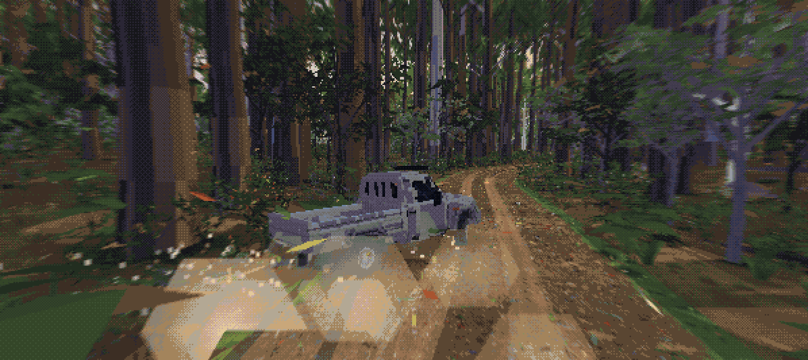
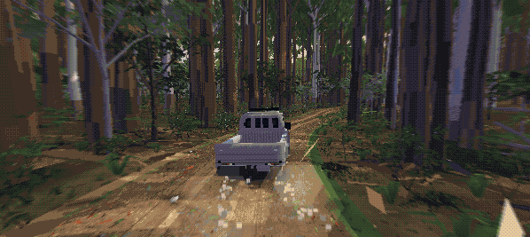

# Bush Drift

A driving game on a real dirt road in the NSW South East Forest: 7.8 km from an old cattlemen's hut down the fire
trails to a creek bridge, in a single-cab ute, the Cattleman. Gravel, potholes, ruts and whoa-boys, tall wet forest
either side, real hills, and a pixel-art look.

**Drift** is the scored run to the bridge: hit a tree or a post and it's over. **Explore** unlocks as you play: no
score and no clock, the road both ways and the bush either side of it.

By **Whoa-Boy Games**. This is a play test: things change between builds, and your feedback shapes what comes next.

More pictures: [the gallery on the play-test page](https://whoaboygames.github.io/bush-drift-play/#pictures).

**Play in the browser:** https://whoaboygames.github.io/bush-drift-play/ (keyboard, or touch on a phone; it fills the
window, and F or the ⛶ button goes full screen. On an iPhone, Share → Add to Home Screen opens it full screen.)

**Android:** https://github.com/whoaboygames/bush-drift-play/releases/latest/download/bush-drift.apk (Android 10 or
newer; install steps in the [latest release](https://github.com/whoaboygames/bush-drift-play/releases/latest)).
Install it straight over the last play test. Don't delete the old one: your deer, achievements and records stay.

**Feedback:** the "Tell me how it went" button on the play-test page, or [open an issue](https://github.com/whoaboygames/bush-drift-play/issues/new/choose).

## Controls

| | keyboard | phone |
|---|---|---|
| steer | ← → | the lower left of the screen |
| gas / brake | ↑ / ↓ | the pedals on the right |
| reverse | ↓ again once stopped | the small **R** button (it waits until you've nearly stopped) |
| handbrake | Space | the lever |
| Low Range | L | the stick |
| UHF radio | U | the UHF button |
| the map | M (pauses on it) | MAP |
| pause | Esc | the button top left |
| restart (Drift) / recover (Explore) | R | the arrow / RECOVER |
| full screen (browser) | F | |

A gamepad works too: Start pauses, Select restarts a Drift run, D-pad down is the radio.

## What's new in play test 4

The biggest play test yet: nearly 600 changes in the 18 days since play test 3, and 56 issues closed.
The full list is in the [play test 4 release notes](https://github.com/whoaboygames/bush-drift-play/releases/tag/v0.4-playtest).

**The bush and the hut**
- **Drive anywhere.** Off the track the forest is solid, natural bush right out to the horizon. No invisible walls:
  the edge is big trees, thick scrub and boulders.
- **It slows you down, and it comes down.** Shrubs and tussocks drag by their size and your speed. Saplings, wattles,
  stags and small trees lean, give and fall, or snap. Big gums don't move. What you knock down stays down all day.
- **The local forest's own plants**, remade from photos, and **a much fuller creek** with rock gardens, fallen gums
  and mud that will really bog you.
- **The hut and its camp rebuilt** from photos and video of the real place: the roof, the chimney, the tank, a mown
  lawn, the fire pit, benches and table, and the trees round it placed one by one.

**The Cattleman and driving**
- **Soft ground**: how far you sink depends on your tyre pressure. Air down for sand and bogs, pump back up after.
- **Rollovers** in Explore: up on two wheels, then back down, or over.
- **The throttle controller**: earn it with a Full pull, then set it from Eco 1-9 to Sport 1-9.
- **It wears and breaks**: flats, leaks, bent steering, a holed radiator, fading shocks, wet brakes. Change a tyre
  properly, and fit the kit you've earned in **the Cattleman's garage**. **Damage: Off** in Settings if you'd rather.

**Explore**
- **Quayle's out bush** somewhere new each day: get on the **UHF** and he'll talk you in. He rides in the tray after.
- **Light your own fire**, bring a deer home, and cook the stew. The deer graze and look up as you come near.

**Drift**
- **Drift calls** from **Tidy** up to **Bush legend!**, chains from one corner into the next, and **SPUN!** if you
  lose it. The pot banks itself about 4 seconds after your last slide.

**Sound and looks**
- Wind in the trees, a whipbird and kookaburras, the creek, tyres by the surface, branches on the panels.
- Sharper shadows round the ute, running water with wakes round the rocks, and the ute in finer detail.

**Performance and controls**
- **A steady 60 frames a second** at every test spot on a Pixel 8 Pro, the title in a third of a second, and a
  third of the memory. Settings → **Detail: Normal** for older phones.
- **Full screen on any phone**, new pedals and buttons sized for your screen, and a small **R** for reverse.
- **Tougher saves**: your progress from play test 3 comes with you.

## Things to try

1. **Bush-bash**: leave the track and push through scrub, saplings and small trees. Does it feel right?
2. **Break the ute, then fix it**: get a flat and change it. Air down for the creek, then pump back up.
3. **The creek**: find the way in, crawl the rocks in Low Range, and get yourself out of a bog.
4. **An evening at the hut**: gather wood, light the fire, find Quayle on the radio, and cook the stew.
5. **Drift a full run**: chain corners together and chase the bigger calls.
6. **The garage**: earn a piece of kit and fit it.

**Feedback that helps most:** your phone or computer and whether it ever stutters or gets hot (Settings →
Performance stats shows the frame rate; a screenshot of it is gold), anything that stopped you dead or felt unfair,
anything that looked wrong, a crash or freeze and what you were doing just before, and which bits you kept going back
to.

## Credits

The ute is made from a model by DR1KING100K (CC BY 4.0). Road line © OpenStreetMap contributors (ODbL). Elevation and
tree cover from NSW DEM and imagery © State of NSW (Spatial Services) (CC BY 4.0). Sounds: CC0 and CC BY recordings
from Freesound. Songs: "The Late Cake" by willfarrell85 and "Drift Yodel". Made with raylib. Full credits:
[CREDITS.md](CREDITS.md).

© 2026 Whoa-Boy Games. All rights reserved. See [NOTICE](NOTICE).
